# MuseV2

> Forked from **muse v0.1.6** (`git tag v0.1.6`, github.com/finns0309/muse) on
> 2026-10-15 to grow a Claude-style surface on its own. muse v1 keeps
> iterating on the original architecture in its own folder; the two share
> history up to v0.1.6 and nothing after.
>
> Runs as a separate app (**MuseV2**, `com.finn.musev2`, data in
> `~/Library/Application Support/MuseV2`) with its own NCM API port (10764),
> so it can run next to Muse v1. `/now` + `/spectrum` (for echo) take 10755
> when it's free and fall back to 10765 when v1 already holds it — echo
> follows whichever app started first. The global shortcuts go to the first
> app too; the other is still a click away in the menu bar.

A summon-anywhere command palette for NetEase Cloud Music. Hit
**⌥Space**, change what's playing, and it's gone again. No dock icon, no
windows to manage — it lives in the menu bar and the whole UI is one palette.

When idle it's a small now-playing card: big cover, the title, a progress
line, and an accent color pulled live from the album art that washes the whole
surface. Start typing and it morphs into search. It holds the real `<audio>`
element and plays in the background; closing the window just hides it.

muse is the controller half of a two-app setup. Its companion **[echo](https://github.com/finns0309/echo)**
is a floating-lyrics widget that reads muse's playback state over a local
socket — see [muse ↔ echo](#muse--echo).

> macOS (Apple Silicon), Electron. Built around my own liked-songs library;
> it's a personal tool, not a polished NetEase client.

## Showcase

<p align="center">
  <a href="https://raw.githubusercontent.com/finns0309/MuseV2/main/docs/demo/musev2-demo.mp4">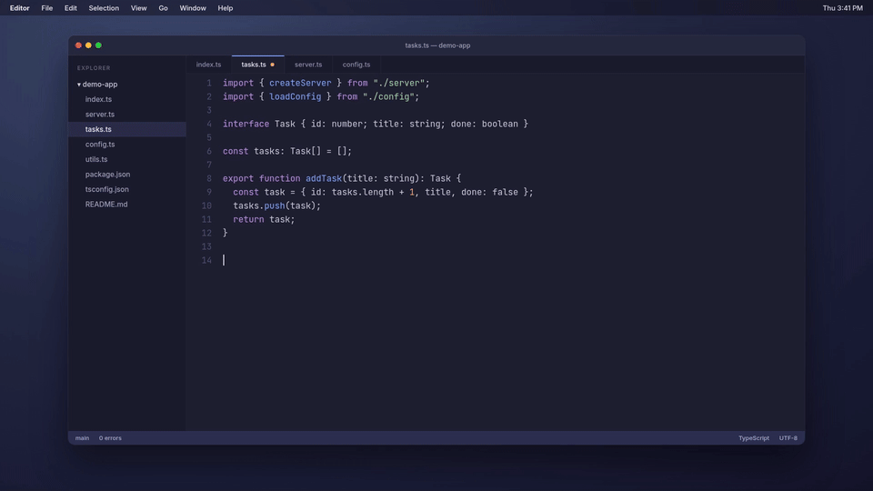</a>
</p>
<p align="center"><sub>Summon. Switch. Gone.</sub></p>

<p align="center">
  <a href="https://raw.githubusercontent.com/finns0309/MuseV2/main/docs/screenshots/claude-01-home-light.png">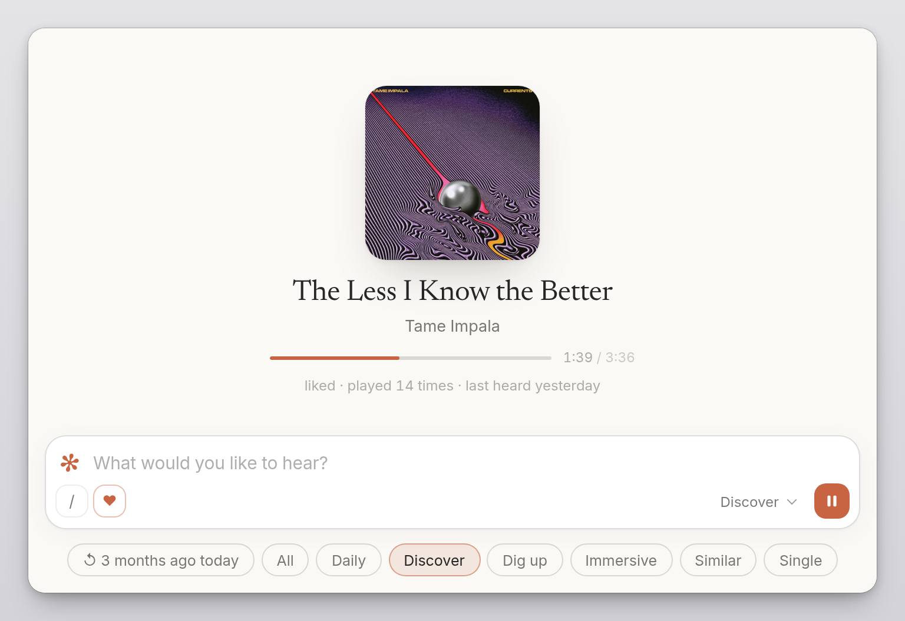</a>
</p>
<p align="center"><sub>Home, on the default Claude theme.</sub></p>

<p align="center">
  <a href="https://raw.githubusercontent.com/finns0309/MuseV2/main/docs/screenshots/claude-02-search-light.png">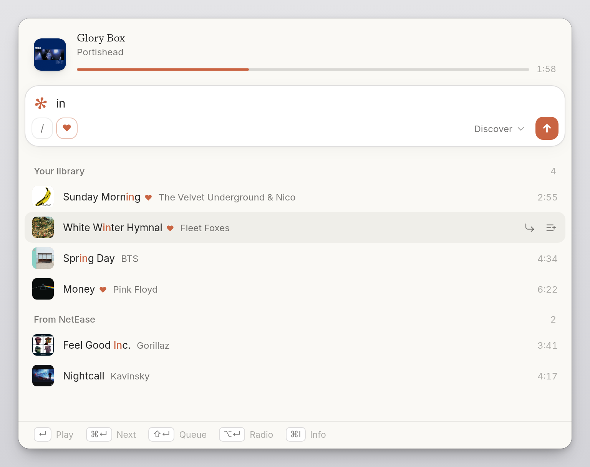</a>
  <a href="https://raw.githubusercontent.com/finns0309/MuseV2/main/docs/screenshots/claude-03-ask-light.png">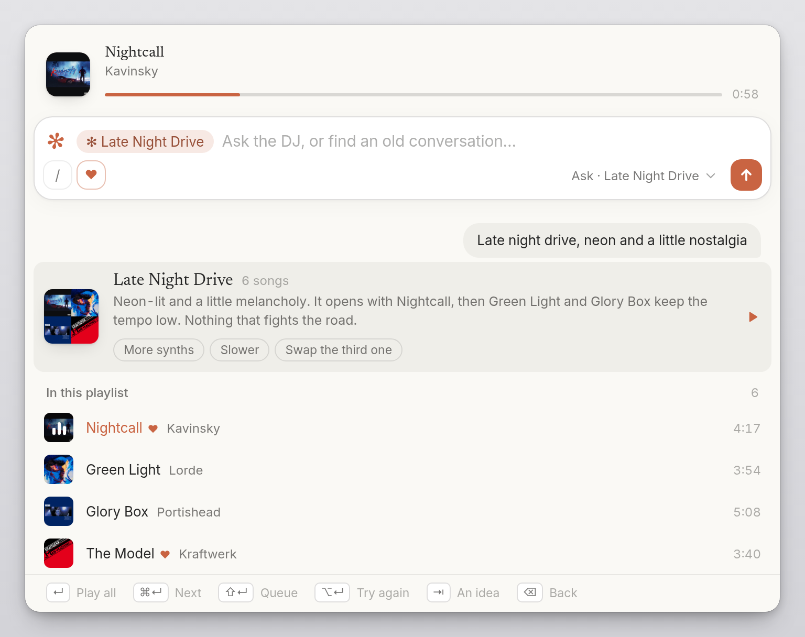</a>
  <a href="https://raw.githubusercontent.com/finns0309/MuseV2/main/docs/screenshots/claude-04-commands-menu-light.png">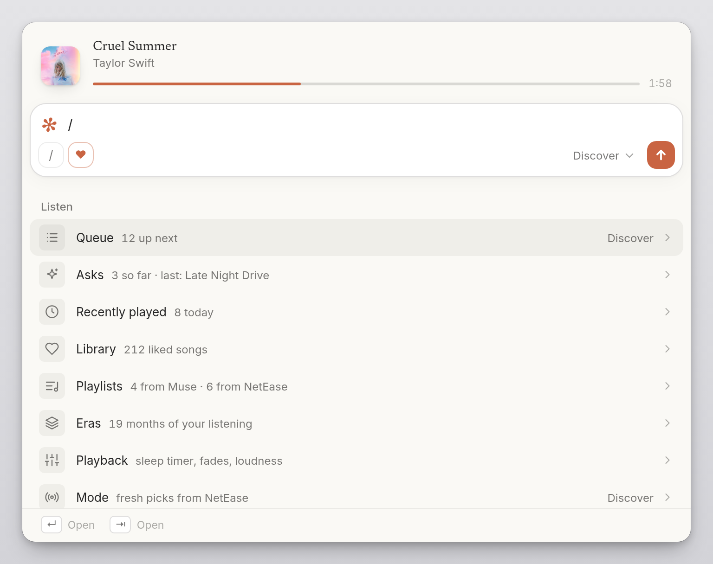</a>
</p>
<p align="center"><sub>Search — highlighted matches, key hints along the bottom.<br>Ask the DJ — a playlist card, and chips to nudge it.<br>Commands — <code>/</code> opens the menu. Each row shows its current value.</sub></p>

### Themes

On **muse** the accent follows the cover. Claude, paper, and mono keep their own ink.

<p align="center">
  <a href="https://raw.githubusercontent.com/finns0309/MuseV2/main/docs/demo/musev2-accent.mp4"></a>
</p>
<p align="center"><sub>Your music sets the color.</sub></p>

<p align="center">
  <a href="https://raw.githubusercontent.com/finns0309/MuseV2/main/docs/demo/musev2-themes.mp4"></a>
</p>
<p align="center"><sub>Four themes. Light and dark.</sub></p>

<p align="center">
  <a href="https://raw.githubusercontent.com/finns0309/MuseV2/main/docs/screenshots/muse-01-home-light-sparkle.png">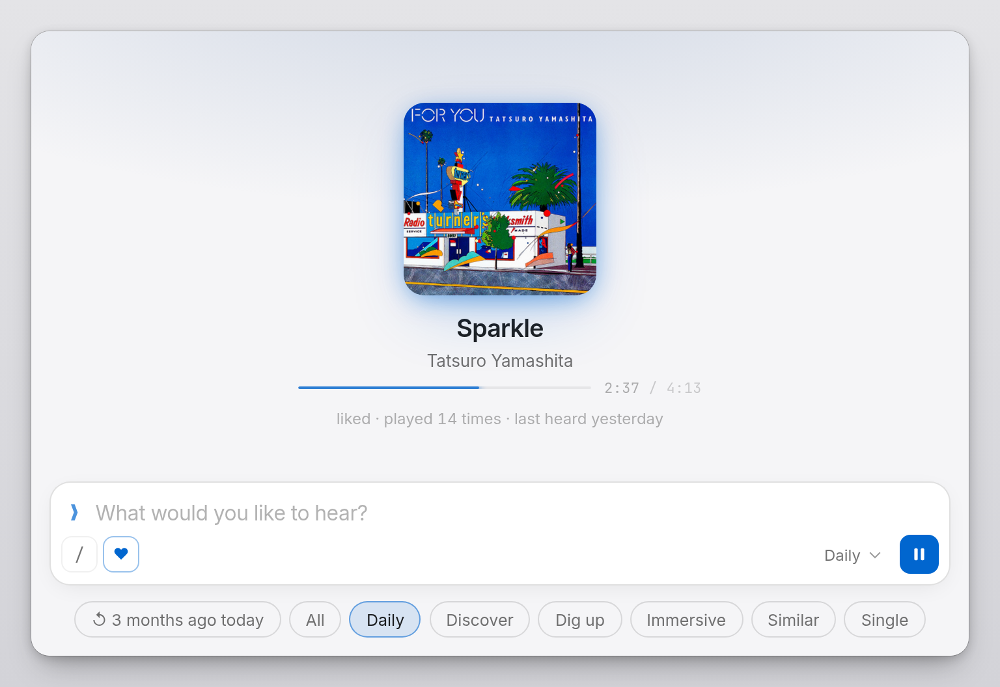</a>
  <a href="https://raw.githubusercontent.com/finns0309/MuseV2/main/docs/screenshots/muse-02-home-dark-brat.png">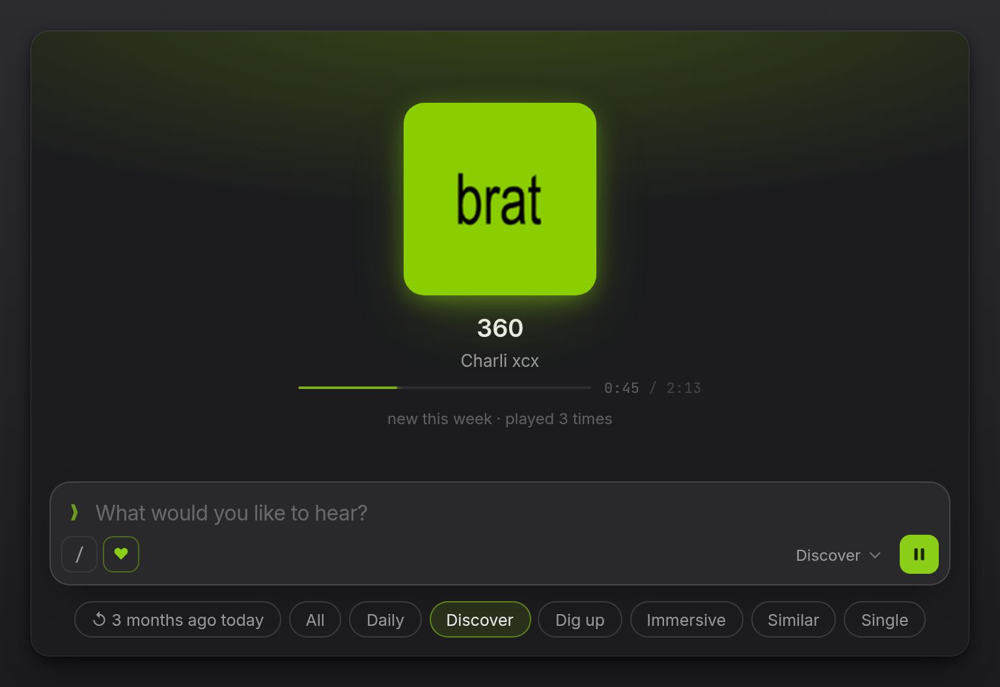</a>
  <a href="https://raw.githubusercontent.com/finns0309/MuseV2/main/docs/screenshots/claude-06-home-dark.png">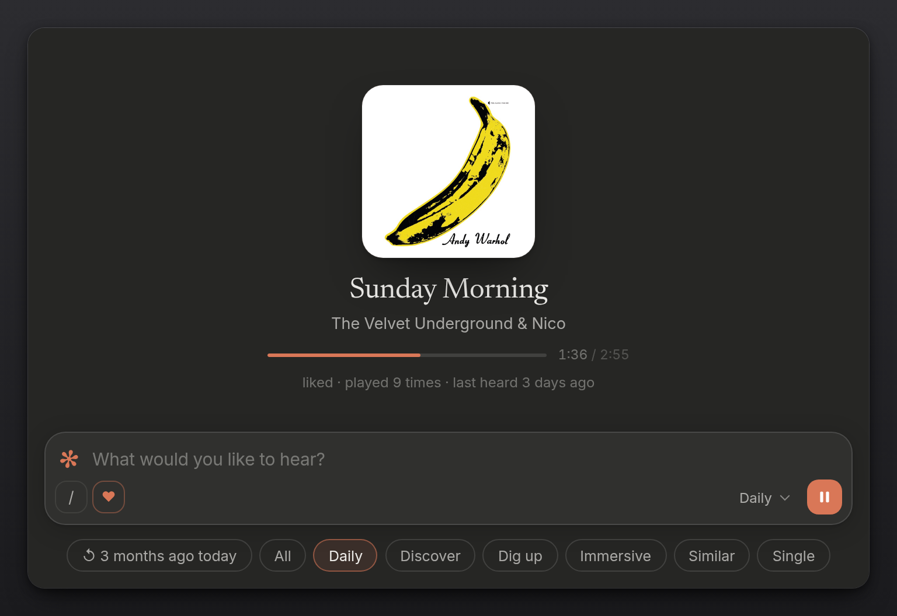</a>
  <a href="https://raw.githubusercontent.com/finns0309/MuseV2/main/docs/screenshots/paper-01-home-light.png">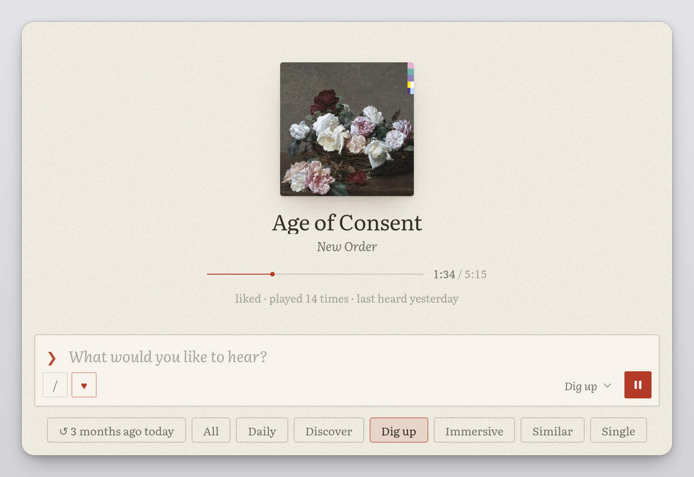</a>
  <a href="https://raw.githubusercontent.com/finns0309/MuseV2/main/docs/screenshots/mono-01-home-dark.png">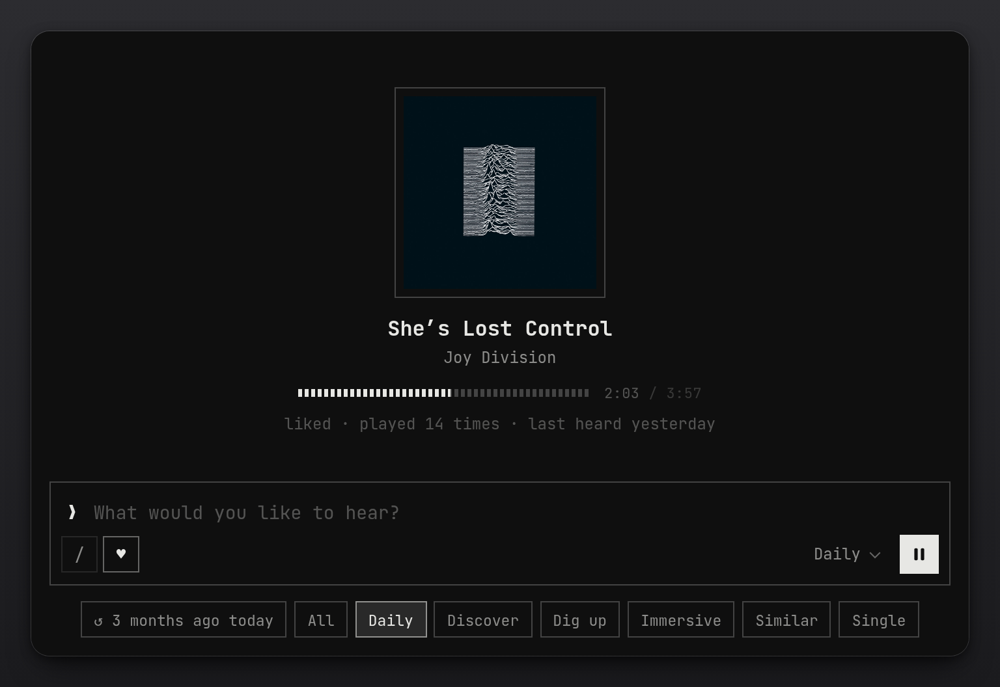</a>
</p>
<p align="center"><sub>Muse, light · Muse, dark · Claude, dark · Paper · Mono</sub></p>

The theme picker, the info card, and search and Ask on muse are in [`docs/screenshots`](docs/screenshots).

## Install

**Download** — grab the latest `.dmg` from
[Releases](https://github.com/finns0309/muse/releases/latest), drag to
Applications. The build is unsigned, so on first launch **right-click → Open**
(double-clicking shows a Gatekeeper warning). First run asks you to scan a QR
with the NetEase mobile app.

**From source**

```bash
git clone git@github.com:finns0309/muse.git
cd muse && npm install && npm start
```

## Usage

Everything happens in the palette. Type to search; prefix with `/` for commands.

| Input | Does |
|-------|------|
| `<query>` | search your library (and NetEase cloud at ≥2 chars). An **Ask Muse** row offers the query to the DJ — on top when it reads like a request |
| `?<request>` | ask the DJ directly: *rainy day, something quiet* · *what I looped most in August* · *like this one, but fewer vocals*. It answers with a titled queue from your own listening; `↵` play all · `⌘↵` next · `⇧↵` queue · `⌥↵` try again |
| `/` | the menu: **Listen** — Queue, Library, Playlists, Mode · **Look** — Appearance, Theme, Accent. Each shows its current value; `Enter` / `→` / `Tab` opens it as a chip in the input, `Backspace` at the start closes it |
| `/<words>` | search every command at once, grouped by menu (`/da` → Daily, Dark; `/claude` → the theme) |
| `/queue <q>` `/lib <q>` | filter the queue (Now playing · Up next · Played) or your library |
| `/pl <id or url>` | load a NetEase playlist and remember it |
| `/recent` | recently played, newest first, a section per day — the time you heard it, `×N` for a song you looped; `↵` plays it again |
| `/era` | your listening by month (plays, the song you played most) — `↵` plays that month's top 50. "↺ N months ago today" sits on top, and as a chip at home |
| `/mode <q>` `/theme <q>` | pick a mode / theme — themes, accents and light/dark keep the menu open so you can flip through them |
| `/appearance` | light / dark, and **Song in the menu bar** — the title beside the tray's ✻ (solid while playing, dimmed when paused, it turns once on each new track) |
| `/sleep` (Playback) | sleep in 15 / 30 / 45 / 60 min (fades out, then pauses) or **after this song**; a `☾ 24m` badge in the toolbar while set. Also **Smooth transitions** (fades between songs and around pauses) and **Even out loudness** (NetEase's ReplayGain-style gain, louder masters turned down) |
| `/accent #d8b35f` | pin an accent (presets: Clay, Vermilion, Lake, Moss, Plum); *Auto* follows the cover in muse, the theme's own ink elsewhere |

| Key | Action |
|-----|--------|
| `⌥Space` | summon from anywhere (also `⌘⇧Space`) |
| `⌘K` | open palette |
| `⌘←` / `⌘→` | previous / next |
| `⌘P` / `Space` | play-pause |
| `⏯ ⏭ ⏮` keys · AirPods · Control Center | play-pause / next / previous; Control Center's Now Playing shows the cover and a scrubbable position |
| `←` / `→` (empty input, at home) | back / ahead 10s (`⇧` for 30s); or click / drag the progress bar |
| `Enter` | run the selection |
| `⌥Enter` | start a radio from this song |
| `⌘Enter` / `⇧Enter` | play this song next / add it to the end of the queue — without interrupting what's playing |
| `⌥↑` `⌥↓` · `⌘⌫` | in `/queue`: move the selected song · remove it (with an empty input) |
| `⌘D` | like / unlike what's playing (`⌘`-click a row to like that song) |
| `⌘C` | with nothing selected: copy the song (selected row, or what's playing) as `title — artists` + its NetEase link |
| `⌘I` | the selected song's story beside the list — liked since, plays, first / last heard, the month you played it most (at home: opens the queue on what's playing) |
| `Esc` | clear the input, then hide the window |

<p align="center">
  <a href="https://raw.githubusercontent.com/finns0309/MuseV2/main/docs/demo/musev2-keyboard.mp4">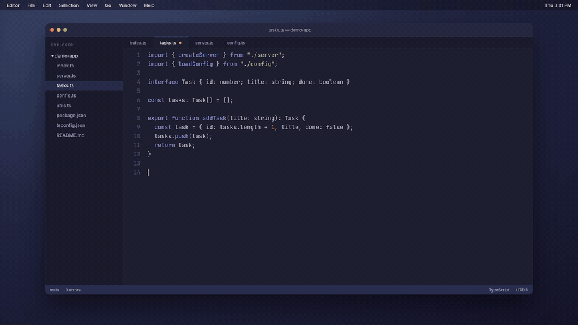</a>
</p>
<p align="center"><sub>No mouse. No context switch.</sub></p>

### Ask (the DJ)

Ask sends one request to an OpenAI-compatible **Responses API** endpoint
from the main process — the key never reaches the renderer. Configure it in
`~/Library/Application Support/MuseV2/llm.json` (never in the repo):

```json
{
  "base_url": "https://…",
  "model": "gpt-6-luna",
  "fallback_models": ["gpt-5.6-luna", "gpt-6"],
  "api_key": "sk-…"
}
```

If the model isn't served, the fallbacks are tried in order. The prompt
carries a compact index of your library plus songs you've played lately, a
per-month most-played timeline, and what's playing — one call, no tool loop,
because each round trip on these endpoints costs 10–20s. Without `llm.json`
the Ask row simply doesn't appear.

<p align="center">
  <a href="https://raw.githubusercontent.com/finns0309/MuseV2/main/docs/demo/musev2-agent.mp4">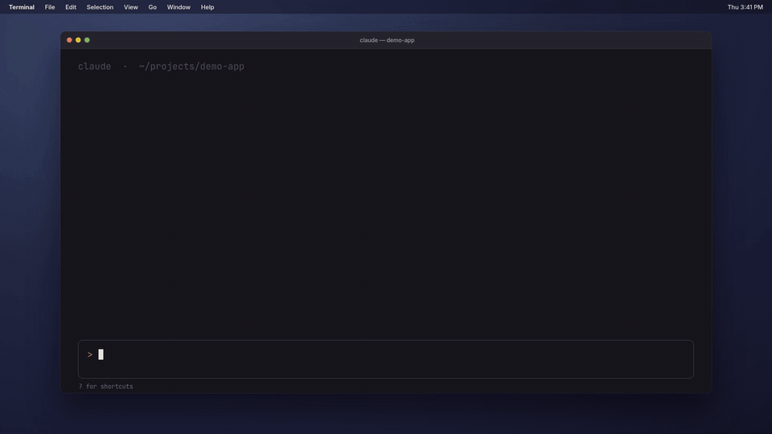</a>
</p>
<p align="center"><sub>Your agent can DJ too.</sub></p>

## How it works

**Library** mirrors your NetEase Liked Songs playlist locally, plus lightweight per-song
metadata (`playCount`, `lastPlayedAt`). NetEase stays the source of truth —
songs you only *play* (search, discover, playlists) never pollute the library;
liking one (`⌘D`) calls `/like` and syncs the mirror.

**Modes** are queue builders — pure functions of `(library, player, now)` that
return a queue: `all`, `daily`, `discover`, `dig up`, `immersive`, `similar`,
`single`. A **playback session** tracks *why* the current queue exists
(`mode` / `manual` / `radio` / `playlist`) so picking a song knows whether to
interrupt the mode or extend it.

**The runtime** owns the single `<audio>` element and broadcasts accurate state
on two local channels, so echo (or anything) never has to guess:

```
GET  http://127.0.0.1:10755/now        authoritative now-playing (songId, position, state)
WS   ws://127.0.0.1:10755/spectrum     24-band audio spectrum + RMS, ~30fps while playing
```

Wire format lives in [`NOW_PLAYING.md`](./NOW_PLAYING.md). A second local server
on `10754` is the NetEase API wrapper.

## muse ↔ echo

The split is deliberate: muse stays small, fast, and mostly-backgrounded; echo
gets to be the visual, always-on lyrics layer. They talk one way only — muse
publishes, echo reads:

```
NetEase  →  muse  ──/now + /spectrum──►  echo
            (control, runtime)            (lyrics, ambient)
```

echo can run standalone off `nowplaying-cli`, but that's lossy (sparse events,
stuck elapsed time, fuzzy title matching). When muse is running it gets the
exact `songId` and position instead.

## Local data

Stored under Electron's `userData`, atomic writes (corrupt files quarantined as
`.bad-<ts>.bak`):

- `cookie.txt` — NetEase login
- `data/library.json` — liked-songs mirror + play metadata
- `data/history.json` — play events (365-day retention)
- `data/ui-prefs.json` — mode, appearance, accent
- `data/saved-playlists.json` — playlists remembered via `/pl`

## Project layout

```
main.js              Electron app, window, tray, global shortcuts; NCM API +
                     /now + /spectrum servers; cookie / store / history
preload.js           the window.muse IPC bridge
lib/store.js         JSON store (one file per key, atomic, quarantine-on-corrupt)

renderer/
  app.js             boot: prefs → auth → mount cmdk → library sync → mode runner
  cmdk.js            the palette: DOM, render, cursor, keys, window resize
  commands.js        builders for queue / library / playlist / mode / search
  player.js          the <audio> element, queue, scrobble, /now + spectrum push
  accent.js          pull accent + ambient color from album art
  transitions.js     summon / hide / cover / title / track-change animations
  glyphs.js          the canonical Unicode glyph set (❯ ♥ ▶ ↳ ▸ ◆)
  playlist.js        NetEase playlist load + local bookmarks
  store.js           tiny pub/sub store (select / selectKey / race)
  auth.js  api.js    QR login; NetEase API wrapper (retry, realIP, auth hooks)
  modes/             queue builders + session.js
  lib/               library mirror, similar, artist helpers
```

## Develop & release

`npm start` to develop. `npm run build` for a local `.dmg`. `npm run release`
publishes to GitHub Releases. See [`RELEASING.md`](./RELEASING.md) for the full
flow (token setup, Gatekeeper note, troubleshooting).
